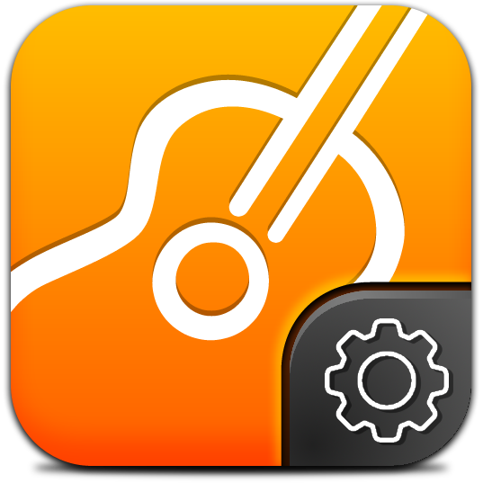

# Cifra Club Helper



[Acessar o Cifra Club Helper](https://brunosilvestre00.github.io/cifra-club-helper/)

Editor visual para preparar cifras e tablaturas para o Cifra Club. Organize músicas por artista e trabalhe em blocos de **Letra**, **Arranjo** ou **Arranjo com letra**.

O armazenamento é **no navegador, usando IndexedDB**. Não é necessário manter uma API ou um banco na nuvem. Os dados não são enviados ao GitHub.

## Executar

Requer Node.js 22.18+ (linha 22 LTS) ou 24 LTS para as ferramentas de desenvolvimento.

```powershell
npm install
npm run dev
```

Abra o endereço apresentado pelo Vite, normalmente `http://127.0.0.1:5173`. Encerre o servidor antigo antes de iniciar esta versão.

```powershell
npm run build
npm run preview
```

O diretório `dist/` pode ser servido em hospedagem estática. Não abra `index.html` diretamente como arquivo.

## Biblioteca, backup e importação

- A página inicial busca e ordena músicas por artista, nome, criação ou última alteração (`modified_at`). Os cards mostram criação e modificação.
- No modo normal, o card inteiro abre a música. Clique em **Exportar seleção** para entrar no modo de exportação: os cards passam a selecionar/desselecionar e mostram checkboxes; os botões de excluir ficam ocultos. **Cancelar exportação** restaura a navegação.
- **Selecionar todas** e **Desselecionar todas** aparecem apenas no modo de exportação. Selecionar todas inclui a biblioteca inteira, mesmo com um filtro de busca ativo.
- Atalhos no modo de exportação: **Ctrl/⌘+A** seleciona todas; **Ctrl/⌘+Shift+A** desseleciona. Campos de texto mantêm seus atalhos normais de edição.
- **Exportar seleção** baixa um único JSON com várias músicas e os artistas associados. Ao selecionar todas, o arquivo inclui também artistas cadastrados que ainda não têm músicas.
- **Importar biblioteca** aceita esse backup completo e os projetos JSON individuais anteriores. O arquivo inteiro é validado antes de gravar qualquer dado.
- A chave de repetição é **slug do artista + slug da música**. A mesma música de artistas diferentes é permitida; a mesma chave não gera cópias.
- Antes de confirmar a importação, a tela mostra quantas músicas são novas e quais são repetidas. Por padrão, as repetidas são ignoradas. Marque **Atualizar músicas já existentes** para substituir seu conteúdo com o arquivo, mantendo o ID local e a data de criação.
- Repetições dentro do próprio arquivo também são detectadas. Uma colisão de ID entre músicas com chaves diferentes gera um novo ID, sem sobrescrever a outra música.
- O formato de biblioteca é versionado (`cifra-club-helper-library`, versão 1), inclui artistas, músicas completas e data de exportação. O limite de importação é 50 MB e 5.000 músicas por arquivo.

Os dados pertencem à origem e ao perfil do navegador. Ao trocar de computador, navegador, `localhost`/`127.0.0.1` ou hospedagem, exporte a biblioteca e importe no destino. Limpar os dados do site pode apagar a coleção local: guarde backups JSON.

## Editor

- `/new` e `/:artist-slug/:song-slug` usam a mesma tela. O endereço definitivo aparece após o primeiro salvamento. O slug da música permanece estável ao renomear; trocar de artista muda o segmento do artista. Links antigos de um só slug continuam sendo reconhecidos na interface.
- Clique no título no topo para editá-lo. Enter ou sair do campo confirma; Escape cancela. O título da aba e os metadados acompanham a edição.
- Selecione um artista cadastrado ou escolha **Cadastrar novo artista** no seletor.
- A lateral mostra a estrutura. Selecione um bloco para editar apenas ele. Duplique, exclua, reordene pelas setas ou arraste pela alça.
- Partes predefinidas: **Música inteira**, Introdução, Verso, Pré-refrão, Refrão, Interlúdio, Solo, Ponte e Final.
- **Letra** contém várias linhas e acordes por sílaba. Clique na prévia da linha para inserir um acorde; arraste ou ajuste sua posição para reposicionar.
- **Arranjo** usa o braço interativo. Selecione uma ou mais posições em cordas diferentes e confirme com **Adicionar** ou **Enter** com o foco no braço. Uma casa por corda; clicar de novo desmarca. Todas as notas entram juntas, permitindo duetos.
- **Novo evento** insere depois do evento aberto; **No evento selecionado** acrescenta notas às cordas escolhidas. Havendo eventos, um permanece aberto. Excluir seleciona o anterior; excluir o primeiro seleciona o novo primeiro.
- **Arranjo com letra** reúne os dois editores no mesmo bloco. Na saída, a tablatura aparece antes da letra e dos acordes, sob um único título de parte.
- Cada arranjo tem instrumento/afinação próprios: violão de seis cordas ou viola de dez cordas em cinco ordens duplas. Há presets Cebolão E/D e afinação personalizada. Técnicas, pausas, espaçamento e frases são editáveis.
- A prévia completa fica sempre visível e usa Roboto Mono, com acordes em negrito laranja. Clicar em um trecho seleciona seu bloco. Exporte TXT, copie o resultado ou baixe JSON individual pelo botão Exportar.
- O salvamento automático ocorre após 700 ms sem alterações. Atalhos: Ctrl/⌘+S salva, Ctrl/⌘+Z desfaz, Ctrl/⌘+Shift+Z ou Ctrl+Y refaz. Até 100 operações de histórico na sessão.
- A logo do usuário aparece no cabeçalho e no favicon. O botão com sol/lua da Lucide alterna os temas claro e escuro e lembra a escolha no navegador.

## GitHub Pages

```powershell
npm run build:pages
```

Prepara `dist/` com base `/cifra-club-helper/`, `404.html` para rotas da aplicação e `.nojekyll`. Os dados continuam no navegador de cada visitante; o arquivo do banco e as músicas pessoais não são publicados. Para outro nome de repositório, ajuste a base do comando ou use `VITE_BASE_PATH` no build normal.

O workflow `.github/workflows/ci.yml` instala as dependências, executa os testes e gera o build. Pull requests passam por essas verificações; pushes na `main` também enviam `dist/` como artefato e publicam no GitHub Pages. O deploy depende da validação e usa o ambiente `github-pages`. Também é possível executar o workflow manualmente na `main` pela aba **Actions**.

Na configuração inicial do repositório, escolha **Settings → Pages → Build and deployment → Source → GitHub Actions**. Depois envie o código para a `main`. A URL publicada aparece no ambiente `github-pages` e no resultado do deploy. Não é necessário um token pessoal no workflow.

Mantenha o código-fonte na `main`: `dist/` continua ignorada pelo Git e não precisa de uma branch própria. Para que uma alteração seja publicada, todos os testes e o build precisam passar.

## Verificação e arquitetura

```powershell
npm test
npm run build:pages
```

São 55 testes Vitest. Cobrem renderização, duetos, exclusão/seleção de eventos, blocos combinados, importação/exportação de várias músicas, chaves duplas, transações, migração e persistência no IndexedDB. `fake-indexeddb` é usado apenas nos testes.

- `src/domain`: modelo musical estruturado e validado com Zod, artistas, partes e formato dos backups.
- `src/persistence`: IndexedDB, índices únicos, importação transacional e migração.
- `src/render`: saída monoespaçada independente de React.
- `src/store`: Zustand e undo/redo.
- `src/ui`: biblioteca e editores compartilhados.
- `public/fonts`: Roboto Mono Regular/Bold e licença OFL, servidas localmente.

O ambiente de desenvolvimento desta entrega bloqueou o build local com `spawn EPERM` do Vite/esbuild. TypeScript e testes foram executados; a CI no GitHub verifica o build fora dessa restrição. A sessão não disponibilizou navegador de automação: a revisão visual e a colagem no editor real do Cifra Club continuam manuais.

## Limites

Alterações grandes na letra ajustam âncoras por prefixo/sufixo; revise os acordes do trecho substituído. O alinhamento usa caracteres normalizados e fonte monoespaçada, sem garantia de largura para emojis. Trocar instrumento mantém índices das ordens e não transpõe notas; a redução de ordens usadas é bloqueada. Undo/redo não é persistido. Não há áudio, MIDI, transcrição automática nem envio automático ao Cifra Club.

[Cifra de referência](https://www.cifraclub.com.br/nenem-e-manuelzito/preto-velho-simiao/) · [Guia oficial de formatação e Roboto Mono](https://suporte.cifraclub.com.br/pt-BR/support/solutions/articles/64000236814-conheca-o-padr%C3%A3o-para-envio-de-cifras-e-tablaturas)
